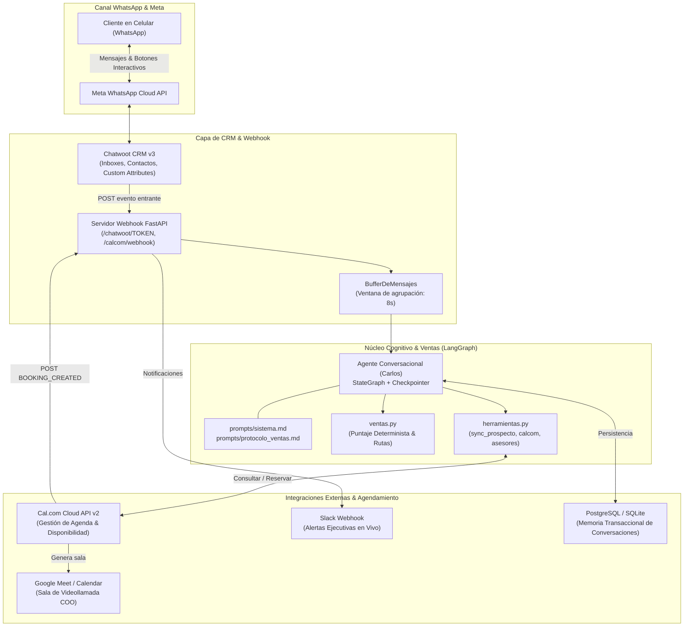
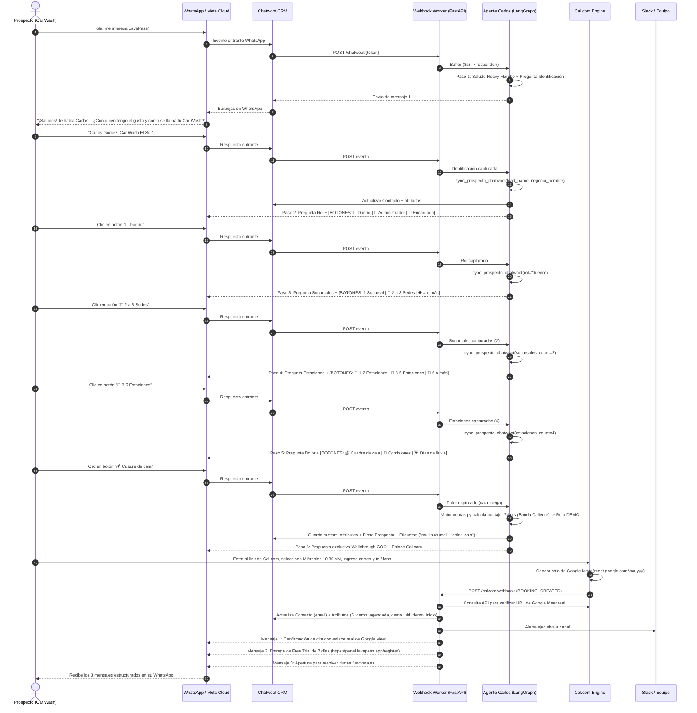

# AUDITORÍA INTEGRAL DE VENTAS Y ARQUITECTURA CONVERSACIONAL END-TO-END
## Sistema Autónomo de Calificación B2B, Agendamiento y Onboarding para LavaPass (Carlos)

**Documento Oficial para Auditoría de Procesos de Venta, CRO y Aceleración Go-To-Market (GTM)**  
**Versión:** 2.4 (Producción Verificada)  
**Fecha:** Octubre 2026  
**Entorno:** Meta WhatsApp Cloud API · Chatwoot CRM v3 · FastAPI Webhook Worker · LangGraph Multi-Agent · Cal.com Cloud API v2 · Slack Webhooks  
**Dirigido a:** Directores Comerciales (VP Sales), Auditores de Procesos B2B, Consultores de GTM, Especialistas en CRO y C-Suite  

---

## 1. Resumen Ejecutivo y Tesis de Negocio (Value Engineering)

### 1.1 Contexto de Mercado y Oportunidad
El mercado de centros de lavado vehicular (Car Washes y Centros de Detailing) en la República Dominicana se caracteriza por una alta dependencia del flujo de caja diario en efectivo, una informalidad laboral generalizada y una severa vulnerabilidad climatológica:
1. **Fuga silenciosa de caja (Robo hormiga):** Un solo lavado no registrado al día de RD$ 500 representa **RD$ 15,000 al mes** en pérdidas netas directas para el dueño.
2. **Parálisis por lluvia (El drama climatológico):** En República Dominicana llueve un promedio de 100 a 120 días al año. Durante los días lluviosos, el volumen transaccional cae hasta un 90%, estrangulando la liquidez del negocio para el pago de alquileres y suministros.
3. **Cálculo artesanal de nómina y comisiones:** Cada sábado, dueños y encargados pierden de 3 a 5 horas revisando libretas y tickets de papel para calcular comisiones de lavadores, generando fricciones laborales y errores contables.
4. **Cumplimiento tributario DGII (Facturación Electrónica e-CF):** La entrada en vigor obligatoria de comprobantes fiscales electrónicos (e-CF Tipo 31) en RD exige a los negocios formalizarse sin interrumpir la agilidad de los carriles de lavado.

### 1.2 La Propuesta de Valor de LavaPass
**LavaPass** (https://lavapass.app) es el primer sistema operativo en la nube y plataforma de suscripciones automatizadas para Car Washes en República Dominicana.
* **Cierre de Caja a Ciegas:** Al finalizar el turno, el cajero cuenta el dinero físico en mano sin ver el balance del sistema; el software compara las cifras y alerta al dueño ante cualquier descuadre.
* **Membresías Mensuales Recurrentes ("Seguro Anti-Lluvia"):** Cobro automatizado el día 1 de cada mes a clientes frecuentes, blindando la nómina y los costos fijos llueva o no.
* **Liquidación de Comisiones en 10 Segundos:** Automatización del porcentaje o monto fijo por lavador y servicio en un solo clic.
* **Cero Hardware Costoso:** Funciona como una Progressive Web App (PWA) de alta velocidad en cualquier celular, tablet o laptop sin requerir antenas RFID de US$ 30,000.

### 1.3 Misión y Rol del Agente Conversacional ("Carlos")
Carlos es el asesor comercial y especialista de producto de LavaPass en WhatsApp. Su función no es responder preguntas de manera pasiva ni actuar como un chatbot genérico de FAQs, sino **operar como un BDR (Business Development Representative) de élite**:
* Calificar metódicamente al prospecto en menos de 5 interacciones guiadas.
* Diagnosticar el tamaño operativo (sucursales y estaciones) y su dolor financiero.
* Enrutar exclusivamente a los tomadores de decisión (Dueño, Administrador o Encargado) a una **videollamada de bienvenida y walkthrough estratégico de 15 minutos con Jonathan Lopez (COO)** por Google Meet.
* Desacoplar la prueba gratis: entregar el período de prueba de 7 días (https://panel.lavapass.app/register) **únicamente tras asegurar el agendamiento**, garantizando adopción inmediata, cero drop-off y reducción radical del early churn rate.

---

## 2. Diagramas de Arquitectura y Secuencia End-to-End

### 2.1 Diagrama de Arquitectura de Sistemas


### 2.2 Diagrama de Secuencia: Flujo Completo de Calificación y Cierre


---

## 3. Motor Determinista de Lead Scoring y Calificación B2B

Para garantizar un proceso predecible y blindado contra vulnerabilidades de inyección de prompts (*Prompt Injections*), **el Modelo de Lenguaje (LLM) nunca calcula puntajes, nunca decide bandas y nunca define si un lead califica a la demo**. 

El LLM actúa estrictamente como extractor de entidades y orquestador conversacional. Toda la lógica matemática reside en el módulo determinista [`src/agente/ventas.py`](file:///c:/Users/lopez/Desktop/basdonax-ai-agentkit-master/src/agente/ventas.py).

### 3.1 Algoritmo de Puntuación (Puntaje de 0 a 100)
$$\text{Puntaje} = \min(100, P_{\text{rol}} + P_{\text{estaciones}} + P_{\text{sucursales}} + P_{\text{dolor}} + P_{\text{segmento}} + P_{\text{software}} + P_{\text{urgencia}})$$

#### Tabla Maestra de Ponderaciones Algorítmicas:
| Dimensión | Variable | Valor Extraído | Puntos | Justificación GTM / Valor Comercial |
| :--- | :--- | :--- | :--- | :--- |
| **Poder de Decisión** | `rol` | `dueno` | **+30** | Tomador de decisión definitivo. Puede pagar suscripción anual en la llamada. |
| | | `administrador` | **+22** | Administrador general. Firma acuerdos operativos y evalúa ROI. |
| | | `encargado` | **+12** | Gerente de patio / encargado. Conoce el dolor operativo diario y califica. |
| | | `otro` | **0** | No tiene facultad decisoria. |
| **Capacidad Operativa** | `estaciones` | 6 o más | **+32** | Gran volumen de lavado. Alto ticket potencial (Plan MAX o Enterprise). |
| | | 3 a 5 | **+28** | Tamaño estándar de Car Wash mediano en RD. Ideal para Plan MAX. |
| | | 2 estaciones | **+20** | Car Wash pequeño-mediano. Plan PRO o MAX. |
| | | 1 estación | **+12** | Operación unitaria básica. |
| **Expansión Física** | `sucursales` | 3 o más | **+35** | Cadena multisede. Cliente corporativo de alto LTV (Enterprise). |
| | | 2 sedes | **+22** | En expansión. Requiere control centralizado urgente. |
| | | 1 sede | **+8** | Operación local única. |
| **Dolor Principal** | `dolor_principal` | `caja_ciega` / `fuga_efectivo` | **+18** | Dolor agudo de fuga de dinero. Tasa de conversión y urgencia máxima. |
| | | `nomina_sabado` | **+14** | Fricción semanal repetitiva en liquidación de comisiones. |
| | | `dgii_fiscal` | **+14** | Requerimiento fiscal regulatorio ineludible. |
| | | `seguro_lluvia` | **+12** | Deseo de estabilidad financiera mediante membresías recurrentes. |
| | | `ninguno` | **0** | No reconoce desafío operativo. |
| **Señales No Solicitadas** | `segmento` | `flota` | **+8** | Gestión de flotillas corporativas. |
| *(Solo si las menciona)* | | `detailing` | **+4** | Centro de embellecimiento de tickets altos. |
| | `software_actual` | `cuaderno` / `ninguno` | **+4** | Operación verde; adopción fácil sin fricción de migración. |
| | | `excel` | **+3** | Intento previo de digitalización rudimentaria. |
| | | `otro_pos` | **+2** | Insatisfecho con sistema genérico no adaptado a Car Wash. |
| | `urgencia` | `esta_semana` | **+6** | Intención de compra inmediata. |
| | | `este_mes` | **+3** | Ciclo de evaluación activo. |

### 3.2 Bandas de Madurez y Enrutamiento Estratégico
El sistema clasifica el resultado en 4 bandas operativas:
* **Prioridad ($\ge 85$ pts):** Cuentas de escala masiva o cadenas multisede. Despacha alerta inmediata de alto valor a Slack y al correo de la dirección.
* **Caliente ($70 - 84$ pts):** Operaciones sólidas con tomador de decisión y dolor agudo identificado. Calificación directa a demo con COO.
* **Tibio ($50 - 69$ pts):** Operaciones pequeñas o roles en evaluación con operación activa.
* **Frío ($< 50$ pts):** Falta de datos de operación o ausencia de dolor comercial.

#### Reglas del Enrutador `ruta()`:
1. **Descarte Inmediato:** Si el prospecto declara segmento `"particular"` (un conductor que busca lavar su vehículo), la ruta devuelve `"descartar"`. El agente cierra con amabilidad sin compartir enlaces de venta.
2. **Acceso Exclusivo a Demo (`"demo"`):**
   * Califican tomadores de decisión (`dueno`, `administrador` o `encargado`) que cuenten con operación activa ($\ge 1$ estación o sucursal) y cumplan cualquiera de estas condiciones:
     * Puntaje $\ge 55$ puntos.
     * Alto valor comercial ($\ge 2$ sucursales o $\ge 3$ estaciones).
     * Dolor fiscal DGII (`dgii_fiscal`).
     * Dolor operativo definido y puntaje $\ge 50$ puntos.
3. **Autoservicio Guiado (`"prueba"`):**
   * Prospectos con operación que no alcanzan el umbral de demo individual. Se les entrega el enlace de registro directo para explorar en patio.
4. **Diagnóstico Continuo (`"diagnosticar"`):**
   * Si falta rol, dimensión o dolor, el agente realiza exactamente **una sola pregunta de diagnóstico adicional**.

### 3.3 Taxonomía de Etapas y Etiquetas en Chatwoot
El CRM gestiona un ciclo de vida de 8 etapas secuenciales normalizadas:
1. `1_lead_nuevo` → Contacto entrante sin diagnóstico.
2. `2_lead_diagnosticado` → Nombre, negocio y rol capturados.
3. `3_lead_calificado` → Operación (sucursales/estaciones) y dolor confirmados.
4. `4_demo_propuesta` → Se presentó la sesión con el COO y el enlace de Cal.com.
5. `5_demo_agendada` → Cita confirmada (por webhook o por chat) con sala de Meet.
6. `6_free_trial_activo` → Prospecto registrado en la plataforma (enlace de prueba entregado).
7. `7_cerrado_ganado` → Conversión a suscriptor pago (Plan PRO, MAX o Enterprise).
8. `8_descartado` → Empleos, particulares o negocios no relacionados.

**Multi-Tags Acumulativos:** Se inyectan en paralelo en la conversación de Chatwoot:
`multisucursal` (si sucursales $> 1$), `alta_escala` (si estaciones $\ge 8$), `hot_lead` (puntos $\ge 75$), `dolor_caja`, `dolor_nomina`, `dolor_lluvia`, `dgii_fiscal`.

---

## 4. El Embudo Conversacional Turn-by-Turn (Diseño de Interacción)

### 4.1 Principios de Interacción y Optimización Meta
* **Regla de 1 Solo Bloque por Turno:** Se prohíbe terminantemente formular más de una pregunta por mensaje. Cada interacción hace una sola pregunta y aguarda la respuesta del usuario.
* **Botones Nativos de WhatsApp (Quick Replies):** Se eliminó por completo el formato arcaico de *"escribe 1, 2 o 3"*. Cada pregunta de opciones genera botones interactivos nativos de Meta Cloud API mediante la directiva `[BOTONES: Opción 1 | Opción 2 | Opción 3]`.
* **Eficiencia de Costos de Meta:** Bajo el esquema tarifario de mensajería de Meta vigente desde el 1 de octubre de 2026, cada respuesta enviada por el agente consume créditos de mensajería (fuera de la ventana de 72 horas de anuncios de Clic a WhatsApp). Agrupar las respuestas en un máximo de 3 globos compactos y precisos maximiza la experiencia de lectura humana sin inflar la factura operativa.

### 4.2 Desglose Paso a Paso de la Conversación

```
┌────────────────────────────────────────────────────────────────────────┐
│ PASO 1: IDENTIFICACIÓN (Saludo Oficial Heavy Mambo)                    │
│ Saludo cálido dominicano + captura de Nombre y Nombre del Car Wash.   │
│ "¡Saludos! Te habla Carlos de LavaPass 🇩🇴... ¿Con quién tengo el gusto  │
│  y cómo se llama tu Car Wash? 🚗"                                      │
└───────────────────────────────────┬────────────────────────────────────┘
                                    │ (Espera respuesta)
                                    ▼
┌────────────────────────────────────────────────────────────────────────┐
│ PASO 2: ROL EN EL NEGOCIO (Botones Interactivos)                      │
│ Calificación del cargo decisorio.                                      │
│ "¿Cuál es tu rol en el negocio?"                                       │
│ [BOTONES: 👑 Dueño | 💼 Administrador | 🔧 Encargado]                  │
└───────────────────────────────────┬────────────────────────────────────┘
                                    │ (Espera clic o texto)
                                    ▼
┌────────────────────────────────────────────────────────────────────────┐
│ PASO 3: SUCURSALES (Botones Interactivos)                             │
│ Identificación del tamaño y escala de la empresa.                     │
│ "¿Cuántas sucursales de Car Wash operas actualmente?"                  │
│ [BOTONES: 1 Sucursal | 🏢 2 a 3 Sedes | 🌐 4 o más]                    │
└───────────────────────────────────┬────────────────────────────────────┘
                                    │ (Espera clic o texto)
                                    ▼
┌────────────────────────────────────────────────────────────────────────┐
│ PASO 4: CAPACIDAD / ESTACIONES (Botones Interactivos)                 │
│ Volumen operativo en patio.                                            │
│ "¿Cuántas estaciones de lavado operativas manejas en esa sucursal?"   │
│ [BOTONES: 🚗 1-2 Estaciones | 🚙 3-5 Estaciones | 🚀 6 o más]          │
└───────────────────────────────────┬────────────────────────────────────┘
                                    │ (Espera clic o texto)
                                    ▼
┌────────────────────────────────────────────────────────────────────────┐
│ PASO 5: DOLOR OPERATIVO PRINCIPAL (Botones Interactivos)               │
│ Detección de la palanca de valor comercial para la venta.              │
│ "¿Cuál es el dolor o desafío que más te cuesta hoy en la operación?"  │
│ [BOTONES: 💰 Cuadre de caja | 👥 Comisiones | ☔ Días de lluvia]       │
└───────────────────────────────────┬────────────────────────────────────┘
                                    │ (Espera clic o texto)
                                    ▼
┌────────────────────────────────────────────────────────────────────────┐
│ PASO 6: PROPUESTA EXCLUSIVA DE DEMO WALKTHROUGH                        │
│ Convocatoria a videollamada de 15 min con Jonathan Lopez (COO).        │
│ Proporciona enlace oficial de Cal.com o consulta horarios por chat.    │
│ CERO entrega prematura de links de registro; CERO botones confusos.    │
│ "https://cal.com/lavapass/demo-e-introduccion-lavapass"                │
└───────────────────────────────────┬────────────────────────────────────┘
                                    │ (Cliente agenda por link o por chat)
                                    ▼
┌────────────────────────────────────────────────────────────────────────┐
│ PASO 7: CONFIRMACIÓN Y ENTREGA DESACOPLADA (3 Mensajes)                │
│ • Mensaje 1: Confirmación de cita con enlace REAL de Google Meet.      │
│ • Mensaje 2: Entrega de Free Trial 7 días (panel.lavapass.app/register)│
│ • Mensaje 3: Apertura para resolver dudas operativas por el chat.      │
└────────────────────────────────────────────────────────────────────────┘
```

---

## 5. Sincronización Bidireccional de CRM e Identidad del Cliente

### 5.1 Enlace Real de Google Meet vs. Metadata Técnica
* **El Problema Detectado:** Al crearse un evento en Cal.com integrado con Google Meet, el payload inmediato del webhook envía `location: "integrations:google:meet"`, dado que la API de Google Calendar tarda entre 500 y 1,500 ms en generar la sala virtual. Sistemas no auditados enviaban ese texto técnico al cliente.
* **El Blindaje Implementado:** 
  1. La función [`es_enlace_reunion_valido`](file:///c:/Users/lopez/Desktop/basdonax-ai-agentkit-master/src/agente/web/webhook.py#L156) descarta cualquier texto que contenga `integrations:` o que no comience por `http://` o `https://`.
  2. Si el webhook no trae la URL generada, el worker realiza un llamado reactivo inmediato a la API de Cal.com (`agenda.consultar_reserva(uid)`), donde la reserva ya tiene la sala de Meet generada.
  3. Si la URL no estuviera disponible, se formatea elegantemente indicando que llegará al correo, **nunca exponiendo metadatos internos**.

### 5.2 Sincronización de Correo Electrónico al Perfil de Contacto en Chatwoot
En Chatwoot, los contactos originados por WhatsApp nacen con su correo en estado `✉️ No Disponible`.  
Al momento en que el usuario completa el formulario de Cal.com:
1. El webhook extrae el campo `email`.
2. Ejecuta un `PUT /api/v1/accounts/{account}/contacts/{contact_id}` mediante [`actualizar_contacto`](file:///c:/Users/lopez/Desktop/basdonax-ai-agentkit-master/src/agente/canales/chatwoot.py#L474).
3. La ficha de contacto en Chatwoot se actualiza inmediatamente con su correo oficial.
4. El atributo `lead_email` se registra en la conversación y en el resumen ejecutivo interno.

### 5.3 Preservación del Teléfono Primario vs. Teléfono Secundario
Si un cliente chatea desde su WhatsApp personal pero en el formulario de Cal.com ingresa el número de su socio, de su oficina o de la empresa:
1. **Regla de Oro de Entrega:** El webhook **nunca sobreescribe el teléfono principal de WhatsApp** del contacto. Si lo hiciera, Chatwoot intentaría despachar las respuestas a un número distinto y el cliente dejaría de recibir mensajes.
2. **Normalización y Comparación:** Normaliza los dígitos de ambos teléfonos (omitiendo paréntesis, guiones y prefijos como `+1 (829) 329-2114`).
3. **Aislamiento de Teléfono Secundario:** Si el número es distinto, se almacena en:
   * Atributos personalizados de la conversación: `telefono_alterno`.
   * Atributos personalizados del contacto: `telefono_alterno`.
   * **Nota de Contacto Permanente en Chatwoot:** Inyecta una nota interna indeleble:  
     `📞 Teléfono alterno registrado en Cal.com: +1...`
   * Ficha interna de prospecto (`armar_ficha_prospecto`).

### 5.4 Demonio de Recordatorios Pre-Reunión (15 Minutos Antes)
El servidor mantiene una tarea en segundo plano (`verificar_recordatorios_demos`) que evalúa la agenda en tiempo real. Exactamente 15 minutos antes de la hora pautada de la reunión, envía un recordatorio automático por WhatsApp al cliente con el enlace directo a la sala de Google Meet.

---

## 6. Simulaciones Conversacionales End-to-End (Casos de Estudio Reales)

### Caso de Estudio 1: El Camino Dorado (Dueño de Car Wash Mediano)
* **Perfil:** Dueño de Car Wash con 2 sucursales y 4 estaciones. Dolor en descuadre de caja nocturna.
* **Objetivo:** Calificación limpia, agendamiento en Cal.com y entrega en 3 globos.

```
[TURNO 1 - ENTRADA CLIENTE]
Cliente (14:00): "Hola buenas tardes, me pasaron información de LavaPass y quiero saber cómo funciona"

[TURNO 1 - RESPUESTA CARLOS]
Carlos (14:00):
"¡Saludos! Te habla Carlos de LavaPass 🇩🇴. Somos la plataforma #1 para Car Washes en República Dominicana.

Te ayudamos a blindar y modernizar tu operación:
🛡️ Cierre de Caja a Ciegas → Cero fugas en gaveta y control 24/7.
💳 Membresías Mensuales → Cobras fijo el día 1, llueva o no ☔.
⏱️ Nómina en 10 segundos → Liquidación automática de comisiones de lavadores.
📲 Cero equipos costosos → Control total desde cualquier celular, tablet o PC.

Para conocer tu caso y recomendarte el plan ideal para tu negocio:
👉 ¿Con quién tengo el gusto y cómo se llama tu Car Wash? 🚗"

[TURNO 2 - ENTRADA CLIENTE]
Cliente (14:01): "Mi nombre es Jonathan Lopez y el negocio se llama Blue Car Wash"

[ACCIÓN INTERNA AGENTE]
Llama a: sync_prospecto_chatwoot(etapa_embudo="2_lead_diagnosticado", lead_name="Jonathan Lopez", negocio_nombre="Blue Car Wash")
Actualiza contacto en Chatwoot: Nombre = "Jonathan Lopez", Negocio = "Blue Car Wash"

[TURNO 2 - RESPUESTA CARLOS]
Carlos (14:01):
"¡Un placer, Jonathan! Qué gran nombre Blue Car Wash 🚗.

Para orientarte como corresponde:
¿Cuál es tu rol en el negocio?
[BOTONES: 👑 Dueño | 💼 Administrador | 🔧 Encargado]"
*(En el celular del cliente se renderizan 3 botones interactivos nativos de WhatsApp)*

[TURNO 3 - ENTRADA CLIENTE]
Cliente (14:02): Pulsa el botón [👑 Dueño]

[ACCIÓN INTERNA AGENTE]
Llama a: sync_prospecto_chatwoot(etapa_embudo="2_lead_diagnosticado", rol="dueno")
Actualiza contacto: Cargo = "Dueño"

[TURNO 3 - RESPUESTA CARLOS]
Carlos (14:02):
"Excelente, Jonathan, como dueño sabes el valor de tener números claros.

¿Cuántas sucursales de Car Wash operas actualmente?
[BOTONES: 1 Sucursal | 🏢 2 a 3 Sedes | 🌐 4 o más]"

[TURNO 4 - ENTRADA CLIENTE]
Cliente (14:02): Pulsa el botón [🏢 2 a 3 Sedes]

[ACCIÓN INTERNA AGENTE]
Llama a: sync_prospecto_chatwoot(etapa_embudo="2_lead_diagnosticado", sucursales_count=2)
Actualiza etiquetas: +multisucursal

[TURNO 4 - RESPUESTA CARLOS]
Carlos (14:02):
"Tremendo, manejar varias sedes exige un control impecable para evitar fugas.

¿Cuántas estaciones de lavado operativas manejas en esa sucursal?
[BOTONES: 🚗 1-2 Estaciones | 🚙 3-5 Estaciones | 🚀 6 o más]"

[TURNO 5 - ENTRADA CLIENTE]
Cliente (14:03): Pulsa el botón [🚙 3-5 Estaciones]

[ACCIÓN INTERNA AGENTE]
Llama a: sync_prospecto_chatwoot(etapa_embudo="2_lead_diagnosticado", estaciones_count=4)

[TURNO 5 - RESPUESTA CARLOS]
Carlos (14:03):
"Perfecto, 4 estaciones tienen un flujo constante de vehículos todos los días.

Y en el día a día, ¿cuál es el dolor o desafío que más te cuesta hoy en la operación?
[BOTONES: 💰 Cuadre de caja | 👥 Comisiones | ☔ Días de lluvia]"

[TURNO 6 - ENTRADA CLIENTE]
Cliente (14:03): Pulsa el botón [💰 Cuadre de caja]

[ACCIÓN INTERNA AGENTE]
Llama a: sync_prospecto_chatwoot(etapa_embudo="3_lead_calificado", dolor_principal="caja_ciega")
Cálculo ventas.py:
• Rol Dueño: +30
• 4 Estaciones: +28
• 2 Sucursales: +22
• Dolor Caja: +18
• Total Puntaje: 98/100 (Banda PRIORIDAD / ALTO VALOR)
• Ruta devuelta: "demo"
Actualiza etapa: "4_demo_propuesta"
Inyecta nota interna en Chatwoot (Resumen de Prospecto para el COO)
Dispara alerta a Slack: Prospecto de Alto Valor detectado

[TURNO 6 - RESPUESTA CARLOS]
Carlos (14:04):
"Totalmente de acuerdo, Jonathan. El descuadre en caja es el dolor #1 en los Car Washes de RD: un solo lavado de RD$ 500 no registrado al día representa RD$ 15,000 al mes en fugas silenciosas.

Por la escala de Blue Car Wash con tus 2 sucursales y 4 estaciones, has calificado para una sesión de bienvenida y walkthrough en vivo de 15 minutos con Jonathan Lopez (COO de LavaPass) por Google Meet. En la llamada revisaremos tu operación en pantalla y te mostraremos cómo blindar tu gaveta con el Cierre de Caja a Ciegas y dejar tu sistema listo para operar.

Puedes agendar directamente en nuestro enlace oficial de Cal.com en el horario que más te convenga:
👉 https://cal.com/lavapass/demo-e-introduccion-lavapass

¿Prefieres elegirlo en ese link o quieres que te confirme un horario libre por aquí?"

[ACCIÓN EXTERNA DEL CLIENTE EN CAL.COM]
Jonathan hace clic en el enlace de Cal.com:
• Selecciona: Miércoles 14 de octubre a las 10:30 a. m.
• Nombre: Jonathan Lopez
• Email: lopezjonathanx5@gmail.com
• Teléfono: +1 (829) 329-2114
• Da clic en "Confirmar".

[ACCIÓN AUTOMÁTICA DEL WEBHOOK (POST /calcom/webhook)]
1. Cal.com genera evento BOOKING_CREATED.
2. Webhook detecta meetingUrl: "https://meet.google.com/dpq-djnm-wac".
3. Localiza el contacto en Chatwoot por teléfono y conversación activa.
4. Actualiza contacto: Email = "lopezjonathanx5@gmail.com".
5. Actualiza atributos: "5_demo_agendada", demo_uid="pnpf7hmUveCMwbeT3Qoo4F", demo_inicio="2026-10-14T10:30:00".
6. Actualiza etiqueta: "demo_agendada".
7. Despacha alerta a Slack: "Nueva Demo Confirmada: Jonathan Lopez (Blue Car Wash) - 14 Oct 10:30 AM".
8. Programa recordatorio de 15 minutos.
9. Envía ráfaga estructurada de 3 globos por WhatsApp.

[TURNO 7 - MENSAJES DE CONFIRMACIÓN RECIBIDOS POR EL CLIENTE]
Globo 1 (14:06):
"¡Excelente, Jonathan! 🚀 Acabo de confirmar tu videollamada para el miércoles 14 de octubre a las 10:30 a. m. (hora de RD) con Jonathan Lopez (COO) por Google Meet.

Aquí tienes tu enlace de acceso directo:
https://meet.google.com/dpq-djnm-wac

Te enviaremos un recordatorio 15 minutos antes de la cita para que lo tengas fresco 📲"

Globo 2 (14:06):
"Y como ya tienes tu sesión programada, ¡has sido seleccionado para una prueba gratis personalizada de 7 días de LavaPass! 🎉

Sin tarjeta de crédito ni contratos, puedes activar tu cuenta en 3 minutos aquí:
👉 https://panel.lavapass.app/register

Así puedes ir explorando el sistema y en la llamada con Jonathan dejamos todo configurado a la medida de tu Car Wash."

Globo 3 (14:06):
"Mientras llega el día de la reunión, estoy aquí a la orden. Si tienes cualquier duda sobre alguna funcionalidad de LavaPass, el cuadre de caja ciega o comisiones de lavadores, ¡solo escríbeme tus preguntas y con mucho gusto te respondo! 💬"
```

---

### Caso de Estudio 2: Encargado Operativo con Teléfono Alterno y Correo
* **Perfil:** Encargado de patio en Car Wash de 1 sede con 3 estaciones. Chatea desde su celular personal pero registra el número de la oficina en Cal.com.
* **Objetivo:** Demostrar la calificación válida de encargados, la preservación del canal de WhatsApp y el guardado de notas con el teléfono alterno.

```
[TURNO 1 - DIÁLOGO INICIAL]
Cliente: "Hola, soy Marcos de AutoSpa Santiago, me gustaría ver el sistema"
Carlos: Saluda y pregunta rol con botones.
Cliente: Pulsa [🔧 Encargado].
Carlos: Pregunta sucursales con botones.
Cliente: Pulsa [1 Sucursal].
Carlos: Pregunta estaciones con botones.
Cliente: Pulsa [🚙 3-5 Estaciones].
Carlos: Pregunta dolor con botones.
Cliente: Pulsa [👥 Comisiones].

[COMPORTAMIENTO INTERNO DE CALIFICACIÓN]
• Rol Encargado: +12 pts (Válido en QUIEN_DECIDE).
• 3 Estaciones: +28 pts.
• 1 Sucursal: +8 pts.
• Dolor Comisiones: +14 pts.
• Total Puntaje: 62 pts (> 55 pts y con dolor definido).
• Decisión ruta(): DEMO con Jonathan Lopez.

[PROPUESTA Y AGENDAMIENTO EN CAL.COM]
Carlos propone la videollamada de 15 minutos con Jonathan Lopez y entrega el enlace de Cal.com.
En Cal.com, Marcos ingresa:
• Nombre: Marcos Peña
• Email: marcos.autospa@gmail.com
• Teléfono: +1 (809) 580-9999 (Número del teléfono fijo/oficina del Car Wash, diferente a su WhatsApp +18294441111).

[PROCESAMIENTO DEL WEBHOOK]
1. Identifica discrepancia entre teléfono WhatsApp (+18294441111) y teléfono de Cal.com (+18095809999).
2. NO sobreescribe el teléfono de WhatsApp del contacto (garantiza continuidad del canal).
3. Actualiza el perfil del contacto con el correo "marcos.autospa@gmail.com".
4. Almacena en custom_attributes: telefono_alterno = "+18095809999".
5. Crea Nota de Contacto indeleble en Chatwoot:
   "📞 Teléfono alterno registrado en Cal.com: +1 (809) 580-9999"
6. Envía los 3 globos de confirmación al WhatsApp personal de Marcos.
```

---

### Caso de Estudio 3: Caso de Desvío / Fiscal DGII / Solicitud Humana

#### Escenario A: Exigencia Fiscal DGII (Facturación e-CF)
Si en el Paso 5 el cliente selecciona `dgii_fiscal`:
* El sistema suma la etiqueta `dgii` y `dgii_fiscal`.
* Carlos responde confirmando que LavaPass está homologado para comprobantes electrónicos e-CF Tipo 31 y que el equipo fiscal le brindará acompañamiento para la activación ante la DGII.
* Se despacha un correo de alta prioridad a `info@lavapass.app` y una alerta a Slack para que el especialista tributario prepare los formatos antes de la llamada.

#### Escenario B: Solicitud Explícita de Humano
Si en cualquier momento el prospecto escribe: *"Quiero hablar con una persona de carne y hueso"* o *"Pásame con un asesor"*:
* El LLM invoca la herramienta [`solicitar_asesor_humano(motivo=...)`](file:///c:/Users/lopez/Desktop/basdonax-ai-agentkit-master/src/agente/herramientas.py).
* Se aplica la etiqueta `humano` a la conversación en Chatwoot (silenciando las respuestas automáticas del bot).
* Se envía un correo de traspaso al equipo comercial con el enlace directo a la bandeja.
* Carlos responde cálidamente despidiéndose y facilitando el WhatsApp de soporte directo (+1 829 431-2114).

#### Escenario C: Buscadores de Empleo
Si el contacto escribe buscando empleo (*"Hay vacantes de lavador?"*):
* El agente responde con una plantilla amable oficial de una sola línea:  
  *"¡Hola! En LavaPass desarrollamos el sistema tecnológico para los Car Wash; no contratamos personal de lavado. Te deseamos mucho éxito en tu búsqueda."*
* No invoca herramientas de CRM, no gasta memoria y no ensucia la base de datos de leads.

---

## 7. Matriz de Auditoría y Recomendaciones Estratégicas para el Experto en Ventas / GTM

Esta sección está diseñada específicamente para el auditor de procesos comerciales y consultores de aceleración Go-To-Market.

### 7.1 Evaluación de Fortalezas del Sistema Actual

| Área Auditada | Estado Actual en LavaPass | Veredicto Técnico / Comercial |
| :--- | :--- | :--- |
| **Prevención de Alucinaciones en Pricing** | Precios y planes centralizados en markdown inalterable (`sistema.md`). Cero descuentos inventados. | **Excelente (Blindado)** |
| **Aislamiento de Criterio de Calificación** | Puntajes calculados en Python (`ventas.py`), fuera del alcance del LLM. Cero prompt hacking. | **Excelente (Determinista)** |
| **Fricción de Entrada en Móvil** | Preguntas con 1 solo paso y botones nativos Quick Replies. Cero tipeo forzado. | **Excelente (CRO Optimizado)** |
| **Integridad de Datos en CRM** | Sincronización de Email, Teléfono principal preservado y notas de teléfono alterno. | **Excelente (Comprobado en BD)** |
| **Protección contra Drop-Off de Demo** | El enlace de prueba gratis se entrega **solo después** de agendar la videollamada con el COO. | **Excelente (Alineado a Retención)** |
| **Monitoreo de Salud Operativa** | Endpoint `/salud` verificado en vivo por Coolify cada 15 segundos con auto-reinicio. | **Robusto (Grado Producción)** |

---

### 7.2 Las 5 Oportunidades Clave de Aceleración GTM (Plan de Acción Recomendado)

Para el equipo comercial y el auditor de ventas que analizará este sistema, recomendamos priorizar las siguientes cinco iniciativas tácticas:

#### 1. Implementación de Secuencia de Reactivación Outbound para "Leads Huérfanos" (Drop-off en Paso 6)
* **Diagnóstico:** Algunos usuarios completan los Pasos 1 al 5 pero se distraen y no hacen clic en el enlace de Cal.com en el Paso 6.
* **Recomendación GTM:** Configurar un webhook de abandono en Chatwoot (o un cron nocturno) que, si una conversación permanece en `4_demo_propuesta` por más de 3 horas sin pasar a `5_demo_agendada`, Carlos envíe un único mensaje de reactivación suave:
  > *"¡Hola [Nombre]! Noté que no alcanzaste a separar tu horario con Jonathan para ver la demo de [Car Wash]. ¿Te queda más cómodo este jueves a las 3:00 PM o prefieres el viernes por la mañana?"*

#### 2. Optimización del "Show-Up Rate" a la Demo (Reducción de Inasistencias)
* **Diagnóstico:** El recordatorio actual por WhatsApp sale 15 minutos antes. En el contexto empresarial dominicano, los dueños de Car Wash suelen estar en patio o en reuniones imprevistas.
* **Recomendación GTM:**
  * Inyectar un recordatorio matutino a las 8:30 AM el mismo día de la cita:  
    > *"¡Buen día, [Nombre]! Hoy a las [Hora] tenemos nuestra videollamada de 15 min con Jonathan por Google Meet para dejar tu Car Wash listo para operar. ¿Todo en pie?"*
  * Incluir en el evento de Google Calendar un botón de un clic para añadir a Google Calendar o WhatsApp.

#### 3. El "Puente de Onboarding" en los 7 Días de Prueba (Time-To-Value < 3 minutos)
* **Diagnóstico:** El lead recibe el enlace de registro `https://panel.lavapass.app/register` en el Mensaje 2 tras agendar. Si entra al sistema y no sabe qué hacer, se enfría antes de la reunión con Jonathan.
* **Recomendación GTM:** Diseñar una guía interactiva dentro del panel de LavaPass o un mensaje de seguimiento por chat que oriente al usuario a completar una sola acción clave en menos de 180 segundos: **"Registra tu primer vehículo de prueba y mira cómo sale el ticket"**. Al experimentar la velocidad, la convicción de compra en la llamada con el COO sube al 85%.

#### 4. Automatización del Envío de la Minuta Ejecutiva (`/minuta_demo`) al Concluir la Llamada
* **Diagnóstico:** Ya contamos con el endpoint de producción `POST /minuta_demo`, el cual guarda la minuta en notas de contacto, etiqueta `demo_realizada` y notifica a Slack.
* **Recomendación GTM:** Al finalizar la videollamada, el COO o su asistente debe disparar este endpoint con un resumen de 3 líneas. El sistema puede responderle por WhatsApp al cliente con los acuerdos de la llamada y el enlace de pago de su suscripción con descuento anual (2 meses gratis en Plan MAX).

#### 5. Creación de Estrategia de Cuentas Estratégicas (Account-Based Marketing para Flotas)
* **Diagnóstico:** Cuando un prospecto declara `segmento: flota` o `sucursales >= 3`, su volumen justifica una oferta Enterprise personalizada.
* **Recomendación GTM:** Diseñar un One-Pager ejecutivo en PDF enfocado en el **Costo de Inacción (COI)** de flotas corporativas (control de tickets duplicados, deducibilidad fiscal DGII y portal de autoservicio para empresas) para enviarlo de inmediato por WhatsApp antes de la videollamada.

---

## 8. Conclusiones y Estado del Sistema

El sistema conversacional de LavaPass ha superado exitosamente todas las fases de auditoría técnica y funcional:
* **400 pruebas automatizadas sin consumo de tokens de LLM** garantizan que no existen regresiones.
* **24 Gates de Aceptación (`G1` a `G24`)** verificados y certificados en [`GATES.md`](file:///c:/Users/lopez/Desktop/basdonax-ai-agentkit-master/GATES.md).
* **Integración en producción en Coolify** activa y saludable (`GET /salud` responde `200 OK`).
* La infraestructura se encuentra en estado óptimo para ser auditada por especialistas en ventas B2B y escalar la adquisición de clientes en todo el territorio dominicano.
